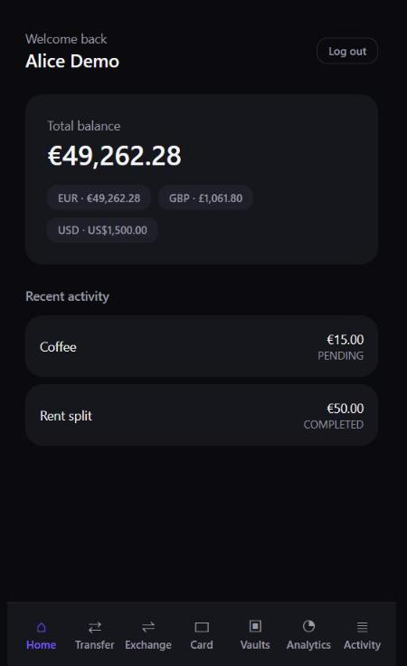
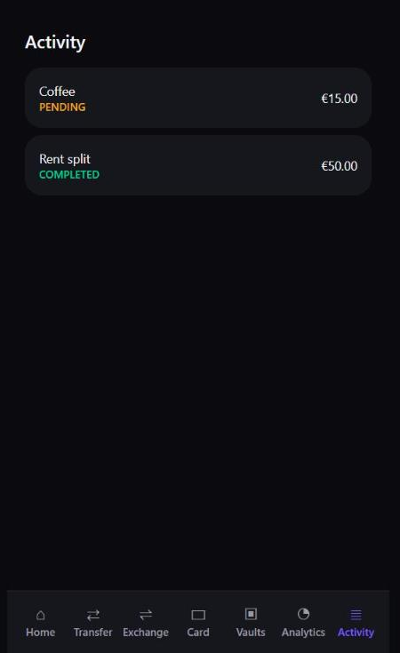
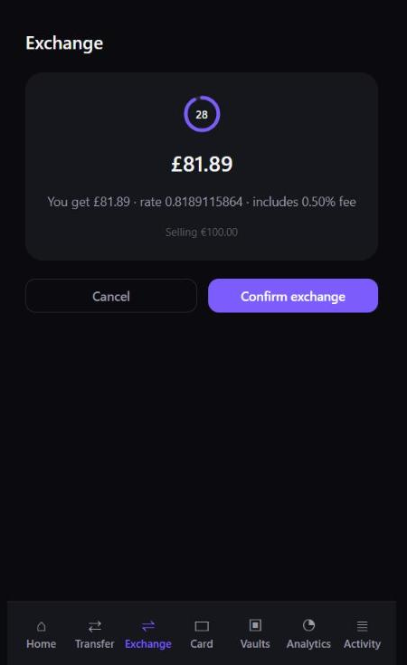
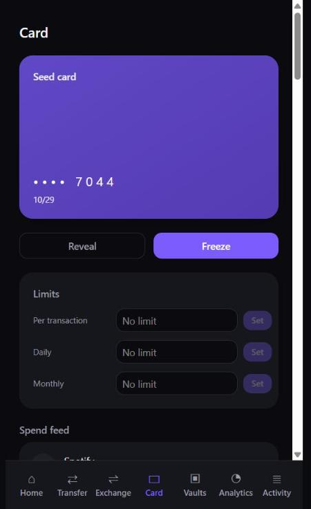
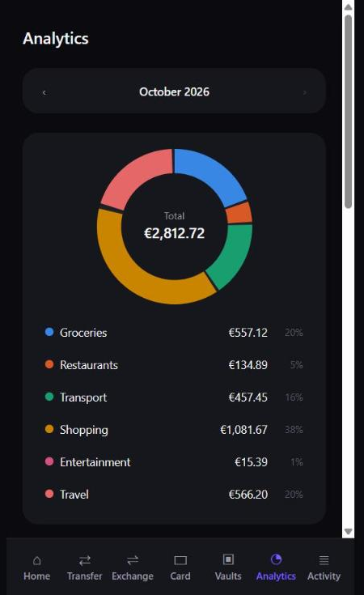
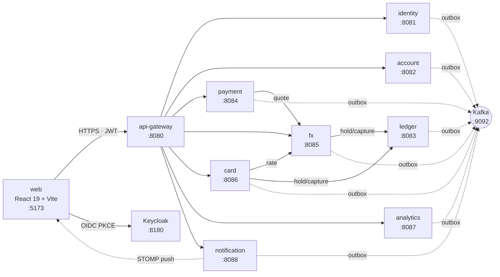
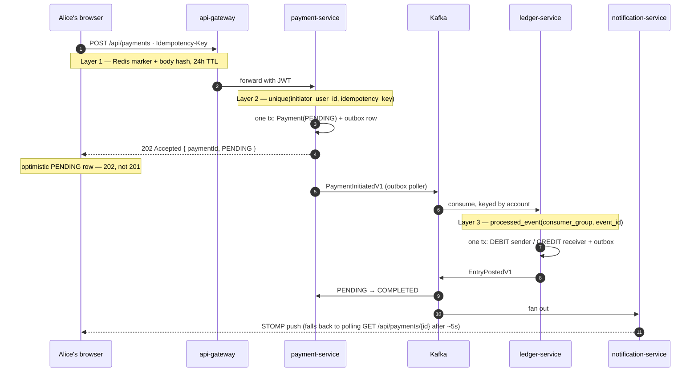

# Revolut Clone

[](https://github.com/<owner>/<repo>/actions/workflows/ci.yml)

<!-- Replace <owner>/<repo> above with this repo's actual GitHub path once it has one - this
     project has no git remote configured as of this commit, so the real path isn't knowable
     from inside the repo. -->

A Revolut-style neobank built to practise distributed-systems engineering: a double-entry
ledger, event-driven choreography over Kafka, sagas with compensation, idempotency under
retries, and a UX that makes eventual consistency visible.

**This is a learning project, not a production system.** Regulation and compliance are
explicitly out of scope — there is no KYC, no real money movement, no licensing. The value is
in the engineering: ten Spring Boot services, each owning its own Postgres database, talking
through Kafka and a transactional outbox, fronted by a React app and backed by a real
Keycloak realm.

## Screenshots

| | |
|---|---|
|  Home — total balance across currencies, recent activity |  Activity — every payment that touched one of your accounts |
|  Exchange — a firm, time-boxed quote before you confirm |  Card — freeze, reveal, per-period limits, the spend feed |
|  Analytics — a replayable projection, not a live query over the ledger | |

## Quick start

```bash
git clone <repo> && cd Revolut
GIT_SHA=$(git rev-parse --short HEAD) docker compose -f docker-compose.infra.yml -f docker-compose.yml --profile services up -d
.\tasks.ps1 seed
```

The first command brings up all ten services, the web app, and five infra containers
(Postgres, Kafka, Redis, Keycloak, Kafka UI) — **under 3 minutes** on a machine with the
images already built, every container waiting on a genuine readiness signal rather than a
fixed sleep (see [`docs/performance.md`](docs/performance.md#8-cold-start-phase-09-task-093)).
The second seeds four demo users through the real public APIs — never a direct SQL insert —
funds their wallets, and generates realistic card spend, transfers, and FX activity, in
**under 60 seconds**.

Then open <http://localhost:5173> and log in as `alice@demo.io` / `demo`. The dashboard should
already be populated: real balances in three currencies, a card with ~75 transactions behind
it, a budget, a vault, and a handful of settled transfers. `.\tasks.ps1 demo` runs a narrated,
scripted walkthrough (fund → transfer → exchange → card spend → settle → dashboard) if you'd
rather watch the system move money than click through it yourself.

## Architecture



Nine services own one Postgres database each and never read another's — state is shared only
by publishing events, through a transactional outbox, keyed by the entity whose ordering
matters (usually the account id). The handful of synchronous calls above are the exceptions,
each with a documented reason; everything else is Kafka. The full system-context diagram, the
complete event/topic catalogue, the ledger data model, and the five-leg FX entry all live in
[`docs/architecture.md`](docs/architecture.md).

**One transfer, start to finish** — three layers of idempotency, an accepted-not-completed
response, and a result that arrives over a WebSocket (or a poll, if the socket dropped):



### Port map

| Service | Port | | Service | Port |
|---|---:|---|---|---:|
| `api-gateway` | 8080 | | `card-service` | 8086 |
| `identity-service` | 8081 | | `analytics-service` | 8087 |
| `account-service` | 8082 | | `notification-service` | 8088 |
| `ledger-service` | 8083 | | `simulator-service` | 8089 |
| `payment-service` | 8084 | | web (React/Vite) | 5173 |
| `fx-service` | 8085 | | Kafka UI | 8090 |
| Postgres | 5432 | | Redis | 6379 |
| Keycloak | 8180 | | Kafka | 9092 |

## The interesting decisions

**Double-entry over mutable balance columns.** A `balance` column that `UPDATE`s in place has
no history and no way to prove it's correct after the fact — a bug that double-credits an
account leaves no trace once the next transfer overwrites it. Immutable postings mean every
balance is a derived, re-computable fact, and the zero-sum invariant is checkable at any time,
not just at write time. The cost is a second table and a cache column to keep in sync.
→ [ADR 0002](docs/decisions/0002-double-entry-ledger.md)

**Transactional outbox over publishing to Kafka inside the request.** A direct broker publish
inside a `@Transactional` method can succeed while the surrounding transaction rolls back, or
vice versa — there is no atomic way to write to Postgres and Kafka in the same operation. The
outbox makes the local commit the only source of truth; a poller drains it with `FOR UPDATE
SKIP LOCKED`, so N replicas can run the same poller safely. The cost is publish latency bounded
by the poll interval, not zero.
→ [ADR 0003](docs/decisions/0003-transactional-outbox.md)

**Partition key = the account id, not the payment id.** Kafka only guarantees order within a
partition, and the thing that must never reorder is two events about the *same account* — a
debit and a credit landing out of order would corrupt a balance. Keying by account id makes
that guarantee free; keying by payment id (tempting, since it's the natural primary key) would
let two payments touching the same account race. The cost is a hot account can create a hot
partition.
→ [ADR 0004](docs/decisions/0004-partition-by-account-id.md)

**Three layers of idempotency, not one.** A client-generated `Idempotency-Key`, checked at the
Redis-backed edge (fast, but Redis may be flushed), the service's own unique constraint (slow,
but the actual guarantee), and a consumer-side `processed_event` table (catches a redelivered
Kafka message, which the first two layers never see). Belt and braces on purpose — a payment
is the one place "probably fine" isn't good enough.
→ [ADR 0006](docs/decisions/0006-idempotency-at-three-layers.md)

**Authorization holds modelled as reservations, not postings.** A card authorization isn't
money moving yet — it's a promise that money *will* move, with a timeout. Modelling it as a
`reservation` row (moving `available` to `reserved`, no journal entry) instead of a tentative
posting means an expired hold is just a state change, not a reversal that has to balance
against an entry that should never have existed.
→ [ADR 0009](docs/decisions/0009-auth-holds-as-reservations.md)

**Analytics as a replayable projection, not a service with its own writes.** `analytics-service`
never originates money and owns no authoritative state — it rebuilds entirely from
`ledger.entry.v1` and `card.authorization.v1` replayed from offset zero. That makes a bug in
the projection logic fixable by dropping the schema and replaying, not by writing a migration
that repairs bad data. The cost is retention: those two topics must never expire, or the
rebuild is permanently incomplete.
→ [ADR 0010](docs/decisions/0010-analytics-as-replayable-projection.md)

**202 Accepted, not 201 Created, on `POST /api/payments`.** The payment hasn't happened yet —
only the instruction to attempt it has been durably accepted. Returning 201 would claim a
money movement that hasn't settled, which is a lie the moment the ledger later rejects it for
insufficient funds. 202 is the honest contract for an asynchronous system, even though it
means the client's "success" screen has to say "pending," not "done."

## What I'd do differently

**`payment-service` calling `fx-service` synchronously for a quote is the one real compromise
in the architecture**, and I'd resolve it before building anything further on top: a user needs
a firm rate before confirming a cross-currency transfer, so the call exists, behind a circuit
breaker, with a documented fallback. The honest fix — `fx-service` publishing to a compacted
rate topic and `payment-service` materializing a local rate view — was deliberately deferred
(see `docs/architecture.md`'s note on it) so that a later resilience experiment would have a
real synchronous coupling to remove, rather than a hypothetical one. If this were heading
toward production, that refactor would come before the next feature, not after.

**The retry/DLT relay has a real design flaw under a large backlog**, found live rather than in
review: `RetryTopicRelay` sleeps synchronously on the listener thread for the retry delay (up to
10 minutes at the slowest level) under manual-ack mode, so a backlog built up during an outage
can make a single poll batch exceed `max.poll.interval.ms` and trigger a rebalance loop that
never actually drains. It's documented as a known residual rather than fixed, because fixing it
properly means moving the delay off the listener thread entirely (a scheduled redelivery table,
not a sleeping consumer) — a bigger change than patching the symptom.

**I'd write the seed data's zero-sum check as a standing CI gate from day one**, not add it in
Phase 08. `docs/failure-modes.md` §0 found that the ledger invariant query `CLAUDE.md` and
`agent/gate.ps1` both describe had never actually run against live data before that phase —
every earlier phase's gate believed it was checking the invariant continuously and wasn't. The
query existed; nothing executed it outside a unit test's fixture data.

**Native SQL is scattered by necessity** (the outbox poller, the balance trigger, the
reconciliation query, the analytics upserts) rather than isolated behind one seam, because each
one needs a Postgres-specific feature (`SKIP LOCKED`, a deferred constraint trigger, `jsonb`,
`ON CONFLICT`) that doesn't have a portable equivalent. I'd rather have found that out and
written it down (`docs/architecture.md` §7) than pretend the database layer is swappable when
it demonstrably isn't.

## Running the tests, load testing, failure experiments

- **`mvn clean verify`** from the repo root runs every service's unit and Testcontainers-backed
  integration tests (Docker must be running). `npm run build && npm run lint` in `web/` for the
  frontend.
- **Load testing** — k6 scenarios, methodology, and every numbered finding (including the
  outbox-poller bottleneck that turned out to matter more than the predicted one) are in
  [`docs/performance.md`](docs/performance.md), with raw `--summary-export` JSON under
  `docs/perf-runs/`.
- **Failure experiments** — eleven chaos experiments run against the real stack (broker down,
  a service killed mid-saga, a poison-pill message, a backlog-triggered rebalance loop) are in
  [`docs/failure-modes.md`](docs/failure-modes.md), including three genuine bugs the experiments
  turned up independent of any chaos lever.
- **Boot 4 / Spring 7 facts**, verified against `docs.spring.io` rather than assumed from
  training data, are recorded with their source URLs in
  [`docs/spring-boot-4-notes.md`](docs/spring-boot-4-notes.md).

## Stack

Java 25 · Spring Boot 4.1.1 · Spring Cloud 2025.1.3 · Maven multi-module · Apache Kafka
(KRaft) · Keycloak (OIDC) · React 19 + TypeScript + Vite · `docker compose`.

The build is driven phase by phase from [`plans/`](plans/00-overview.md) — the actual source
of truth for scope and sequencing; this README won't try to restate it.
