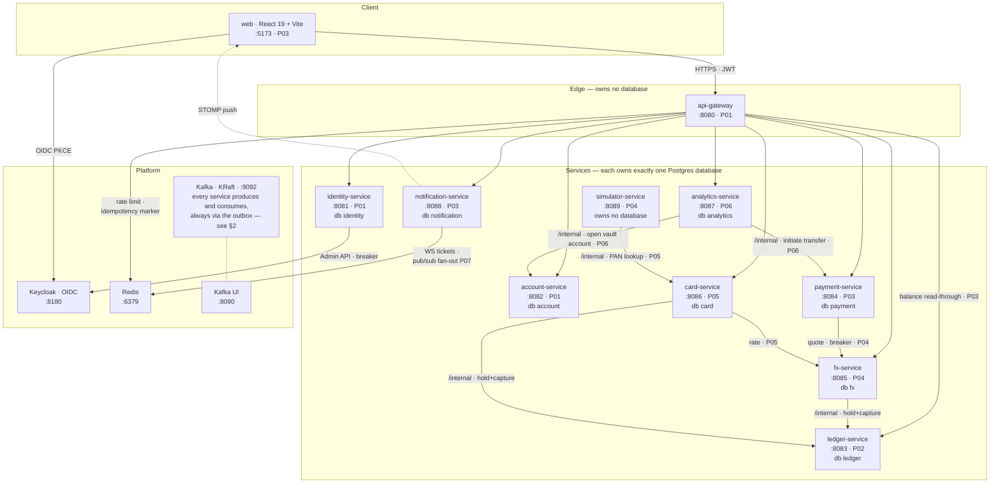
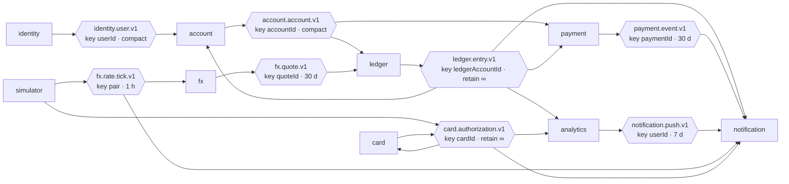
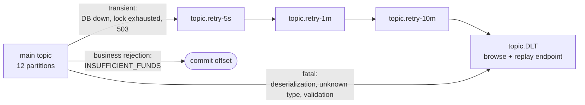
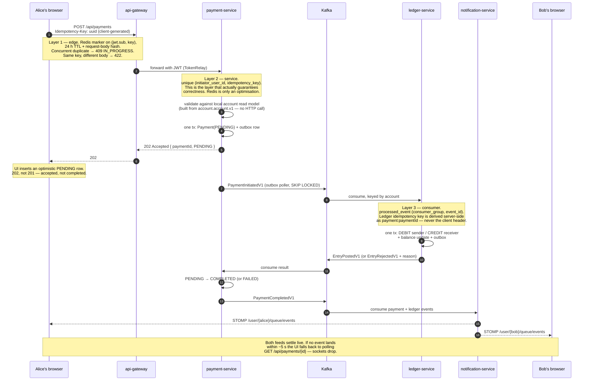
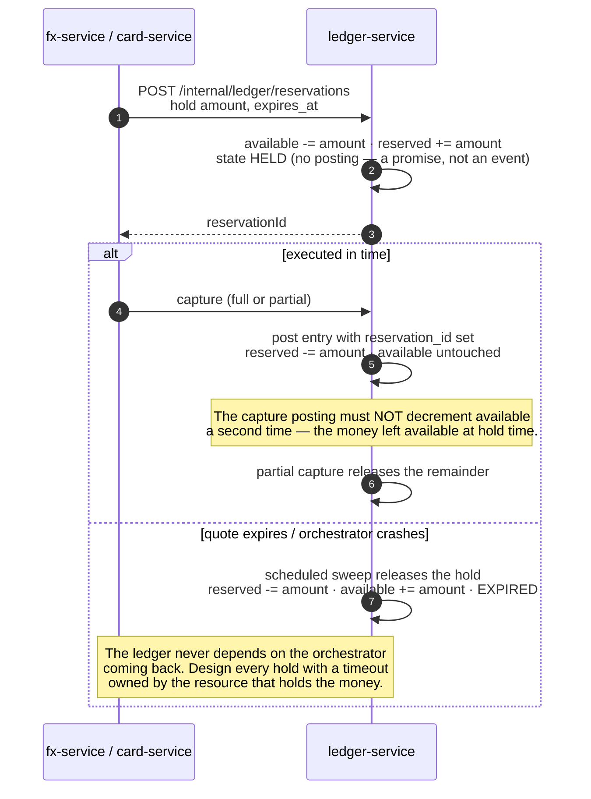
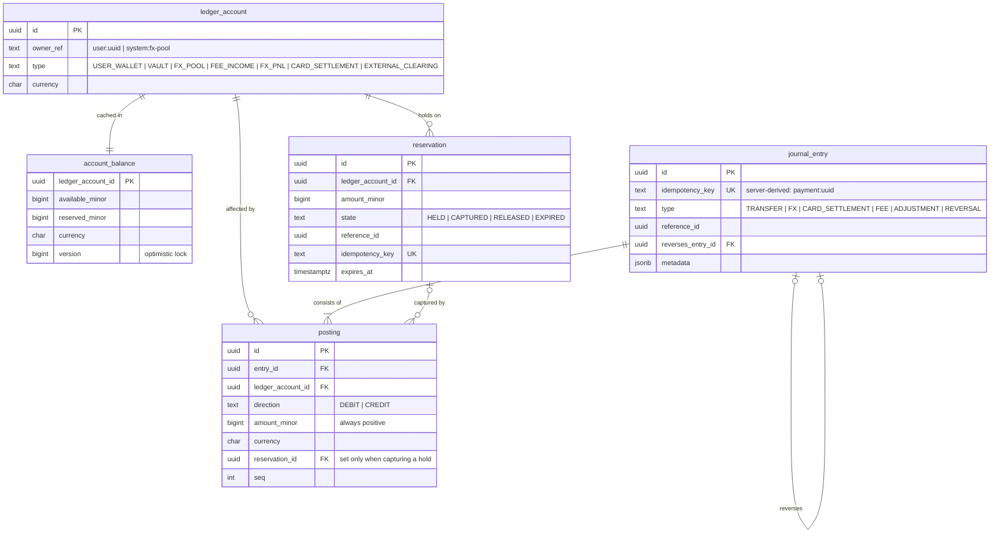

# Architecture

A Revolut-style neobank built as a learning project in distributed-systems engineering:
true microservices, database-per-service, event-driven choreography over Kafka, a
double-entry ledger, sagas with compensation, and idempotency at every layer that touches
money. Regulation and compliance are explicitly out of scope.

> **This document describes the system as built.** Phases 00 through 08 are complete and
> phase 09 (this one) is in progress; every box and every arrow below has been checked against
> the actual code as of task 09.10, not just against [`../plans/`](../plans/00-overview.md).
> Task 09.10's own verification pass found one real drift between the original plan and what
> got built — the gateway's ledger balance read-through, added below — and resolved the one
> open footnote from the planning era. Where something genuinely remains undecided, it is
> marked `?` and footnoted rather than invented.

**Phase badges.** Node labels carry a `P0x` badge for the phase that introduces the
component — `P00` foundations, `P01` identity/account/gateway, `P02` ledger, `P03` payments
and UI, `P04` FX, `P05` cards, `P06` analytics, `P07` resilience. See
[§8 Phase build-up](#8-phase-build-up) for the full mapping.

---

## 1. System context

This map shows the **synchronous** wiring only — every arrow here is a blocking call between
two processes. The asynchronous wiring, which is most of the system, is in
[§2](#2-event-and-topic-flow); collapsing it to one thick arrow is what makes the sparse set
of synchronous hops legible.

**Reading the edges.**

| Edge | Meaning |
|---|---|
| `--->` thin solid | Synchronous HTTP |
| `-.->` dotted | WebSocket / STOMP push, or an operator tool |

**Kafka is drawn unwired on purpose.** It has no synchronous edge to anything — every service
reaches it asynchronously through the outbox, and [§2](#2-event-and-topic-flow) is that
picture.

**`simulator-service` has exactly one synchronous edge, and it exists only because this is not
a real card network.** A real network already knows a card's PAN from the physical swipe; this
one has to ask, because it owns no database of its own and cannot read card-service's
(§1's per-service-database rule) — see `card-service`'s `NetworkPanController` javadoc (P05).
Every other message this service sends or receives — rate ticks, authorization requests,
settlements, reversals — still travels as an event.

**Eight databases, eight non-superuser roles, no cross-reads.** Every service in the box owns
exactly one Postgres database and never reads another's — state is shared by publishing
events. `api-gateway` and `simulator-service` own none; that absence is deliberate.

**The synchronous edges are deliberately few**, and this is the whole list. Any arrow not
below is a bug against the design:

| Call | Why it is allowed |
|---|---|
| browser → gateway → `/api/**` | Routing and edge JWT validation only. Services re-validate; the edge is a fast reject, not a trust boundary |
| `gateway → ledger` | `/api/ledger/**` rewritten to `/internal/ledger/**` - a read-through for `GET .../accounts/{id}/balance`. Every balance the web app shows comes through this route; `account-service` never caches or re-exposes it (database-per-service - balances are ledger-service's alone to answer) |
| `payment → fx` | A cross-currency transfer needs a firm rate before the user confirms. Behind a Resilience4j circuit breaker, fallback `FX_UNAVAILABLE` |
| `card → fx` | Foreign-currency authorization must decide in well under a second |
| `fx → ledger`, `card → ledger` | `/internal/ledger/reservations` — hold and capture. Not routed by the gateway; service-to-service only |
| `simulator → card` | `/internal/cards/{cardId}/pan-for-network` — the merchant network's one legitimate reason to ask for a PAN it doesn't yet have. Deliberately not behind a JWT — see `NetworkPanController`'s javadoc: this project has no service-to-service client-credentials identity yet ([Phase 07](../plans/phase-07-resilience-and-scale.md)) |
| `analytics → account` | `/internal/accounts/vaults` — opens a vault's backing `VAULT`-type account. `analytics-service` owns the `vault` row but never the account or the money behind it — it must never call `ledger-service` directly or post anything itself. Deliberately not behind a JWT, same reasoning as the two rows above |
| `analytics → payment` | `/internal/payments` — initiates an ordinary transfer for vault move-in/move-out, built generally (not vault-specific) so Phase 06's round-up rule reuses the identical endpoint. Deliberately not behind a JWT, same reasoning as the two rows above |
| `identity → Keycloak` | User provisioning via the Admin API, behind `IdentityProviderPort` and a breaker |
| `gateway → Redis` | Per-user rate limiting and the edge idempotency marker |
| `notification → Redis` | Single-use WebSocket tickets; from P07 also the pub/sub fan-out between instances |

> **`payment → fx` is a known compromise, with a date on it.** It is the one sideways HTTP
> call in the system, accepted because the user must see a firm rate before confirming.
> [Phase 07](../plans/phase-07-resilience-and-scale.md) refactors it: `fx-service` publishes
> to a compacted rate topic and `payment-service` materialises a local rate view, removing
> the call entirely. Experiment 7 ("kill `fx-service`, confirm same-currency transfers keep
> working") only teaches anything if the coupling exists first.

`api-gateway` and `simulator-service` own no database — that absence is deliberate. Every
other service owns exactly one, with its own non-superuser role, and never reads another's.

---

## 2. Event and topic flow

Eight topics, all created up front with `auto.create.topics.enable=false`. Every message is
keyed by the entity whose ordering matters, and 12 partitions is chosen because it is highly
composite — consumer groups of 1, 2, 3, 4, 6 or 12 all divide evenly.

| Topic | Key | Parts | Cleanup | Retention | Producer → Consumers | Added |
|---|---|---|---|---|---|---|
| `identity.user.v1` | `userId` | 12 | compact | — | identity → account | P01 |
| `account.account.v1` | `accountId` | 12 | compact | — | account → ledger, payment | P01 |
| `ledger.entry.v1` | `ledgerAccountId` | 12 | delete | **`-1`** | ledger → payment, notification, analytics, account, fx, card [1] | P02 |
| `payment.event.v1` | `paymentId` | 12 | delete | 30 d | payment → notification | P03 |
| `notification.push.v1` | `userId` | 12 | delete | 7 d | analytics (budget alerts) → notification | P03 |
| `fx.rate.tick.v1` | `pair` | 12 | delete | 1 h | simulator → fx, notification | P04 |
| `fx.quote.v1` | `quoteId` | 12 | delete | 30 d | fx → ledger | P04 |
| `card.authorization.v1` | `cardId` | 12 | delete | **`-1`** | simulator, card → card, notification, analytics | P05 |

**The two infinite-retention topics carry the architecture.** `ledger.entry.v1` and
`card.authorization.v1` are what Phase 06 and Phase 07 replay from offset 0 to rebuild the
analytics projection from nothing. If retention ever truncates them, the rebuild silently
produces partial results — which is why Phase 00 verifies `retention.ms=-1` before anything
depends on it.

**The two compacted topics are read-model sources.** Only the latest state per key matters,
so a fresh consumer — `payment-service`'s local account view, for instance — rebuilds its
whole picture on startup with no backfill API and no synchronous call to the owning service.

**Ordering is load-bearing, per key.** `card.authorization.v1` keyed by `cardId` means two
taps on the same card are evaluated in order against the same limits. With random
partitioning, two simultaneous authorizations could both pass a limit that only one should.

[1]: **Resolved (task 09.10).** [Phase 02](../plans/phase-02-ledger.md) task 8 has
`ledger-service` publish `LedgerAccountCreatedV1` so `account-service` can fill in
`account.ledger_account_id`; the plan didn't say which topic carries it, but the actual
implementation puts it on `ledger.entry.v1` itself rather than a dedicated topic - one topic,
multiple event types discriminated by payload shape, not a new topic for a single low-volume
event. This is also why this topic's consumer list is longer than the saga alone would suggest:
`account`, `fx`, `card`, `payment` and `notification` each run their own `LedgerEntryKafkaListener`
and keep a local `LedgerAccountRef`/account-view read model keyed off `LedgerAccountCreatedV1`,
so each can validate a ledger account id locally rather than calling `ledger-service` synchronously
(database-per-service - §1's rule against cross-service reads applies here too).

### Retry and dead-letter chain — P07

Retrying a failing message in place blocks its partition and stalls every other key behind
it. The chain moves it aside instead:

Retry and DLT topics get **3 partitions, not 12** — ordering no longer matters once a
message is in the retry chain.

The middle row is the classic poison-pill outage: a deserialization failure can never
succeed, so retrying it means the partition never advances while the consumer group looks
perfectly healthy. `ErrorHandlingDeserializer` sends it straight to the DLT on the first
attempt.

The bottom row is the subtler one. **A business rejection is not a failure.**
`INSUFFICIENT_FUNDS` is a legitimate outcome that emits `EntryRejectedV1` and commits. If it
throws, you retry a declined payment forever.

---

## 3. The transfer saga

Same-currency P2P transfer, Alice to Bob. Four events and a state machine, written by hand —
no saga framework.

**There is no compensation step here**, and that is not an omission: the ledger posts the
whole entry or none of it, in one local transaction. Compensation first appears in Phase 04,
when FX adds a second resource.

**The durability demonstration.** Stop `ledger-service` mid-transfer and the payment sits at
`PENDING`. Start it again and the transfer completes on its own with no user action — the
event was on the log the whole time.

### Hold → capture, and the one real compensation path

FX quote execution (P04) and card authorization/settlement (P05) share this shape. The
reservation is the compensation mechanism, and its timeout belongs to the ledger, not to the
orchestrator:

---

## 4. Ledger data model

The most important schema in the project. Immutable journal entries, a balance cache
maintained in the same transaction, and reservations that move money between columns without
creating a posting.

Every service additionally carries `outbox_event` and `processed_event` from
`common-messaging`, in its own database.

### Sign convention

> **A user wallet is a liability of the bank to the customer. A CREDIT increases the
> customer's money; a DEBIT decreases it.**

A transfer from Alice to Bob is `DEBIT alice_wallet` / `CREDIT bob_wallet`. Getting this
backwards is the most common bug in ledger implementations and it is invisible until someone
reads a statement.

### Balance-column semantics

Which column a posting moves depends on whether it is capturing a hold. Leaving this implicit
is the easiest way to corrupt the service:

| Posting | Balance effect |
|---|---|
| DEBIT, `reservation_id IS NULL` | `available -= amount` |
| CREDIT, `reservation_id IS NULL` | `available += amount` |
| DEBIT, `reservation_id` set | **`reserved -= amount` only** — the money already left `available` at hold time |

The third row is the one that matters, and the failure is invisible to the headline safety
check: if a capture also decremented `available`, the postings still balance perfectly and
the zero-sum invariant still passes, while every reserved payment quietly destroys money in
the balance cache. Only reconciliation catches it — and only if it compares against
`available + reserved`, not `available` alone.

### The invariant, enforced twice

1. **In code** — `PostingEngine` validates before insert: at least two postings, and per
   currency, `sum(debits) == sum(credits)`.
2. **In the database** — a `DEFERRABLE INITIALLY DEFERRED` constraint trigger on `posting`,
   checked at commit. Deferred is essential: postings are inserted one at a time and the
   entry only balances once they are all in.

Application code eventually gets bypassed — by a migration, a support script, a bug. The
trigger is the thing that actually holds.

---

## 5. The FX entry

A currency exchange is not one entry with two postings. The ledger's invariant is **per
currency**, so both currencies must balance independently, through a pool account acting as
counterparty. That takes five legs, not four.

Alice sells 100.00 EUR and buys 85.43 GBP. Mid 0.8600, spread 50 bps, client rate 0.8543.
All of it is **one journal entry, in one transaction** — the legs below are simultaneous, not
sequential.

**EUR side**

| Direction | Account | Minor | Meaning |
|---|---|---:|---|
| DEBIT | `alice:EUR` | 10000 | Alice loses EUR |
| CREDIT | `system:fx-pool` | 10000 | the pool gains EUR |
| | **net** | **0** | ✓ |

**GBP side**

| Direction | Account | Minor | Meaning |
|---|---|---:|---|
| DEBIT | `system:fx-pool` | 8600 | the pool gives up the **mid-rate** amount |
| CREDIT | `alice:GBP` | 8543 | Alice gains GBP at the **client rate** |
| CREDIT | `system:fee-income` | 57 | the spread, posted explicitly as revenue |
| | **net** | **0** | ✓ |

A sixth leg to `system:fx-pnl` absorbs the sub-unit rounding residual when there is one —
`FxMath` returns both the converted amount and the residual, so this is never a guess.

**Why the fee leg is not optional.** Draw this as four legs at the client rate and it still
balances — but the spread then vanishes into the pool as drift, which is exactly what a pool
balance is worst at telling you about. Posting it explicitly means `FEE_INCOME` answers "what
has the spread earned" and `FX_POOL` means only "what is our currency exposure". Those are
two different questions.

**The pool is meant to be unbalanced in value** — long EUR, short GBP. That is what an FX
book is, and it is why system accounts may go negative while user wallets may not.

If `FEE_INCOME` stays at zero after the first exchange, the pool leg was posted at the client
rate. Every balancing test still passes.

---

## 6. Cross-cutting patterns

| Pattern | What it does | Where |
|---|---|---|
| **Transactional outbox** | Business code calls `OutboxAppender.append(...)` inside its transaction and never touches a broker. A poller drains with `FOR UPDATE SKIP LOCKED`, which is what makes N replicas safe | [P00](../plans/phase-00-foundations.md) |
| **Idempotent consumer** | `processed_event (consumer_group, event_id)` inserted inside the handler's transaction; duplicate key means "already done, ack and move on" | [P00](../plans/phase-00-foundations.md) |
| **Partition key = the entity whose ordering matters** | Usually the account or card id. This is what makes per-key ordering survive a rebalance and a scale-out | [P00](../plans/phase-00-foundations.md) |
| **Database-per-service** | Eight databases, eight non-superuser roles, no cross-reads. State is shared by publishing events, never by sharing tables | [P00](../plans/phase-00-foundations.md) |
| **Three-layer idempotency** | Redis at the edge, a unique constraint in the service, `processed_event` in the consumer. Belt and braces on purpose | [P03](../plans/phase-03-payments-and-ui.md) |
| **Replayable projection** | `analytics-service` owns no authoritative money and can be dropped and rebuilt from offset 0. No `now()` in a projection — bucket by `occurredAt`, always | [P06](../plans/phase-06-vaults-analytics.md) |
| **Ports at three seams** | `IdentityProviderPort` over user provisioning, `EventPublisher`/`OutboxAppender` over the broker, repositories over the database. Deliberately *not* abstracted: Kafka's log semantics and Postgres-specific SQL | [P00](../plans/phase-00-foundations.md), [P09](../plans/phase-09-polish.md) |

**Native SQL lives in exactly four places** across the whole project — the outbox poller, the
balanced-entry trigger, the ledger reconciliation query, and the analytics aggregate upserts.
Everything else goes through Spring Data, which keeps the portability question a checklist
rather than an audit.

**Replay side effects are the hazard.** Rebuilding state is safe; re-firing notifications is
not. Budget alerts guard on `alerted_at_80` / `alerted_at_100` timestamps, and a replay-mode
flag suppresses emission — otherwise a rebuild spams six months of history at the user.

---

## 7. Portability boundaries

The three infrastructure layers sit behind seams, but **they are not equally swappable**, and
pretending otherwise would mean designing to a lowest common denominator that deletes most of
what the project exists to teach.

| Layer | Abstracted | Not abstracted | Realistic swap |
|---|---|---|---|
| **Identity** | User provisioning, roles-claim path | Nothing — OIDC is a real standard | Any OIDC provider: config plus one adapter |
| **Messaging** | Publish/consume call sites, via the outbox | Partition-key ordering, consumer groups, offset replay, log compaction, lag-based scaling | MSK, Confluent Cloud, Redpanda. **Not** SQS/SNS/EventBridge |
| **Database** | Repository access, connection config | Deferred constraint triggers, `FOR UPDATE SKIP LOCKED`, `jsonb`, `ON CONFLICT` | Aurora/RDS Postgres. **Not** MySQL or DynamoDB |

Phase 09 *verifies* these rather than asserting them: run the full suite against Redpanda,
against both identity adapters, and against a TLS-required Postgres with a non-superuser
role. "We swapped the broker and the suite passed" is a far stronger claim than "the
messaging layer is abstracted".

---

## 8. Phase build-up

Read the diagrams above as the end state; this is what exists after each phase.

| Phase | Adds | Effort |
|---|---|---|
| [00 Foundations](../plans/phase-00-foundations.md) | Kafka, Postgres ×8, Redis, Keycloak, Kafka UI; `common-money`, `contracts`, `common-messaging`, `common-web`, `common-security`; the topic catalogue | 3–4 d |
| [01 Identity, Account, Gateway](../plans/phase-01-identity-account-gateway.md) | `api-gateway`, `identity-service`, `account-service`; first outbox event and first idempotent consumer | 3–4 d |
| [02 Ledger](../plans/phase-02-ledger.md) | `ledger-service` — postings, balances, reservations, the deferred trigger, reconciliation | 5–7 d |
| [03a Payment saga](../plans/phase-03-payments-and-ui.md) | `payment-service`, `notification-service`, three-layer idempotency, WebSocket ticket auth | 3–4 d |
| [03b First UI](../plans/phase-03-payments-and-ui.md) | `web/` — login, Home, Transfer, optimistic UI with reconciliation, dev drawer | 3–4 d |
| [04 FX](../plans/phase-04-fx-multicurrency.md) | `fx-service`, `simulator-service` rate feed, quotes with expiry, the five-leg entry, first compensation path | 4–6 d |
| [05 Cards](../plans/phase-05-cards.md) | `card-service`, merchant simulator, controllable clock, auth holds vs settlement | 4–6 d |
| [06 Vaults & analytics](../plans/phase-06-vaults-analytics.md) | `analytics-service` — the first pure read model, round-ups, budgets, replayable projection | 4–6 d |
| [07 Resilience](../plans/phase-07-resilience-and-scale.md) | Retry/DLT chain, circuit breakers, chaos control plane, replay tooling, Redis WS fan-out, consumer scaling | 4–5 d |
| [08 Load & observability](../plans/phase-08-load-and-observability.md) | Prometheus, Grafana, kafka-exporter, k6 scenarios, `docs/performance.md` | 2–3 d |
| [09 Polish](../plans/phase-09-polish.md) | One-command compose, seed data, README, ADRs, CI, portability proofs | 2–3 d |
| [10 Extensions](../plans/phase-10-extensions.md) | Optional: Avro + registry, Debezium CDC, tracing, AWS, Kubernetes | open |

Phases 00–04 are the core; 05–10 are additive and can be resequenced. Phase 03a is a
legitimate stopping point that leaves a working, curl-verifiable system.

---

*Sources: every diagram and table above is derived from [`../plans/`](../plans/00-overview.md).
When the two disagree, the plans are correct and this document is stale.*
